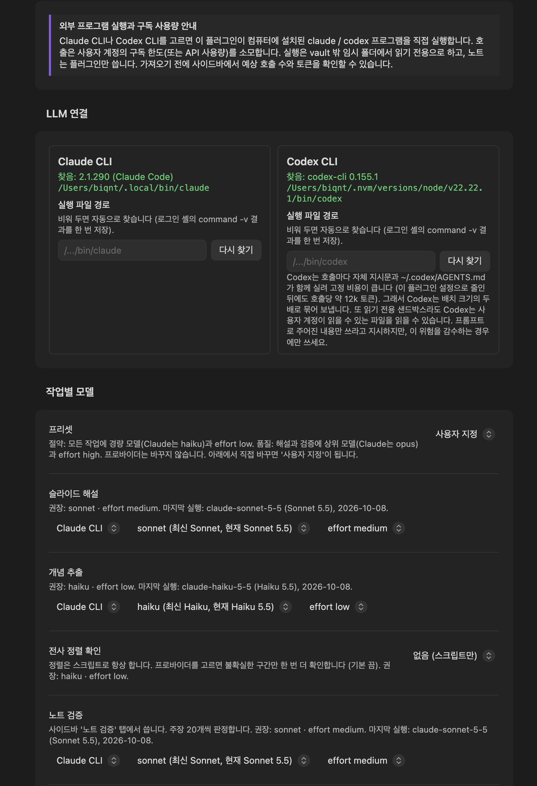
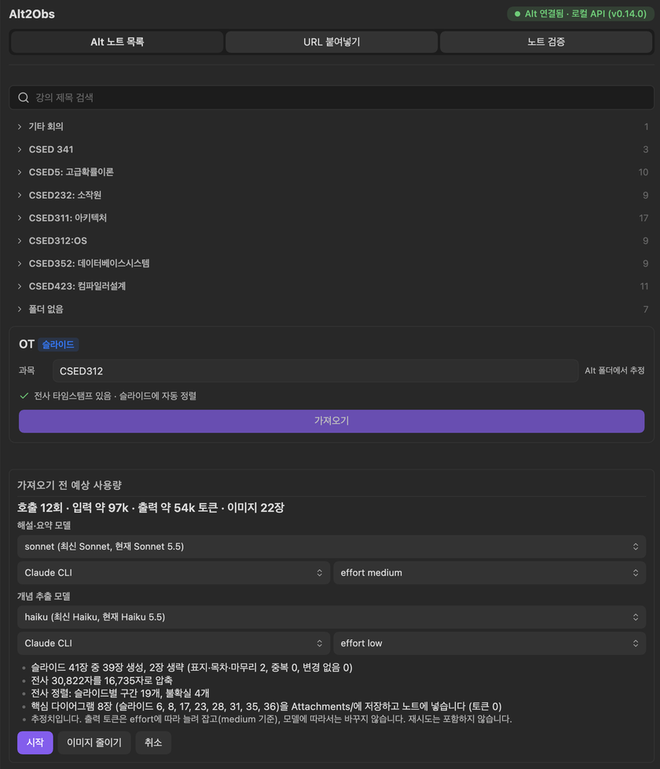
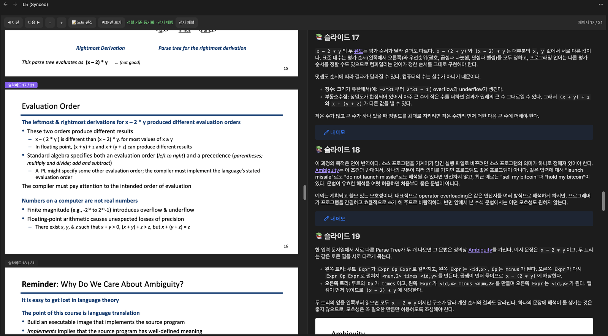
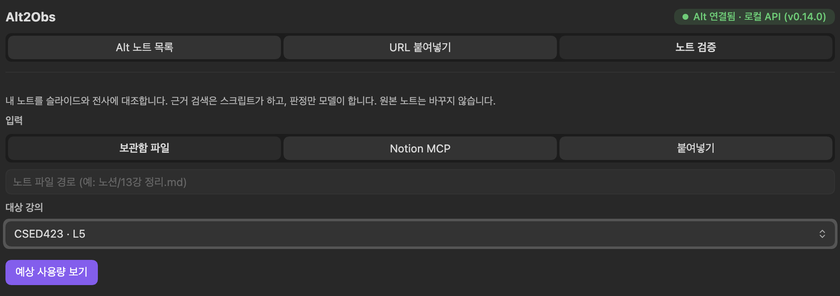

#  Alt2Obs user guide

[한국어](user-guide.ko.md) · [README](../README.md)

This guide covers everything Alt2Obs does, from setup to troubleshooting. The plugin's interface is in Korean, so this guide quotes each label exactly as it appears on screen, followed by an English gloss: **가져오기** (import). Commands are in English; the command palette shows them with the plugin's name in front, for example **Alt2Obs: Open sidebar**.

Try the plugin on a copy of your vault first if you have a lot of existing lecture notes.

## Contents

- [Before you start](#before-you-start)
- [Setup](#setup)
- [Importing a lecture](#importing-a-lecture)
- [The generated notes](#the-generated-notes)
- [Synced Viewer](#synced-viewer)
- [Question panel](#question-panel)
- [Lecture brief](#lecture-brief)
- [Lectures without slides](#lectures-without-slides)
- [Note verification](#note-verification)
- [Migrating from older versions](#migrating-from-older-versions)
- [Settings reference](#settings-reference)
- [Troubleshooting](#troubleshooting)
- [FAQ](#faq)
- [Tested versions and known limitations](#tested-versions-and-known-limitations)

## Before you start

Alt2Obs does not call a model itself. It runs the Claude Code CLI or the Codex CLI on your computer, logged in to your own account. Install one of them and log in once in a terminal:

```bash
# Claude Code
npm install -g @anthropic-ai/claude-code   # or the official installer
claude                                      # run once and log in

# Codex
npm install -g @openai/codex
codex login
```

Every call counts against your plan's limits or your API usage. The [README](../README.md#requirements) lists the full requirements, and its [privacy section](../README.md#privacy-and-disclosures) lists what is sent where.

## Setup

Open **Settings → Alt2Obs**. The box at the top (외부 프로그램 실행과 구독 사용량 안내, running external programs and plan usage) is a reminder that the plugin runs your CLI.

<p align="center"></p>

### LLM connection

Under **LLM 연결** (LLM connection) there is a card for **Claude CLI** and one for **Codex CLI**.

- A CLI that was found shows `찾음: <version>` (found) and its path. A warning under it means the version is older than the tested one, or that its help text does not list every option the plugin uses.
- **실행 파일 경로** (executable path): leave it empty to find the CLI automatically, or enter an absolute path.
- **다시 찾기** (search again) runs the search again.

How the search works: Obsidian started from the Dock or the Start menu does not see your terminal's PATH (nvm and similar tools set it in your shell). So the plugin runs `command -v claude` once in your login shell (`where` on Windows) and also looks in common install folders: nvm, Homebrew, `~/.local/bin`, `~/.claude/local`, `~/.npm-global/bin`, `~/.volta/bin`, `~/.bun/bin`, `/usr/local/bin` (on Windows `%APPDATA%\npm`, `%LOCALAPPDATA%\Programs\claude` and others). Every executable it finds is checked with `--version` and its help text (`claude --help`, `codex exec --help`), with no model call. One that lacks an option the plugin uses is skipped, unless it is at least the tested version (then it is used with a warning). The newest usable one is saved.

On the first start the plugin also checks `claude auth status`. If the Claude CLI is logged in, the tasks use it; if not and the Codex CLI is installed, the tasks are set to the Codex CLI and a notice tells you so.

The Codex card adds a note: each Codex call carries Codex's own instructions and your `~/.codex/AGENTS.md`, about 12k tokens per call even after the plugin trims what it can. To spread that cost, Codex gets twice the batch size. Codex's read-only sandbox can still read files your account can read; the prompt tells it to use only the material it is given, but choose Codex only if you accept that.

**이전 API 키 지우기** (remove old API keys) appears only while API keys from 1.x or early betas are still stored in `data.json`. Nothing uses them now; they stay so a rollback keeps working. The button asks for a second click.

### Task models

Under **작업별 모델** (models per task) each task has a provider, a model and an effort dropdown.

| Task | Used for | Default |
|---|---|---|
| **슬라이드 해설** (slide commentary) | per-slide commentary, the overview, summary note sections | Claude CLI, `sonnet`, effort medium |
| **개념 추출** (concept extraction) | concept notes; also the Notion page fetch when this task is on the Claude CLI | Claude CLI, `haiku`, effort low |
| **전사 정렬 확인** (alignment check) | an optional check of uncertain transcript spans | **없음 (스크립트만)** (none, script only) |
| **노트 검증** (note verification) | judging the claims of your notes | Claude CLI, `sonnet`, effort medium |
| **질문** (questions) | the [question panel](#question-panel) | Claude CLI, `sonnet`, effort low |
| **챗봇 브리프** (chatbot brief) | the AI part of [lecture briefs](#lecture-brief), and **세 줄로 줄여서** (cut to three lines) when saving an answer to a memo | Claude CLI, `haiku`, effort low |

On the Codex CLI the model defaults to Codex's own default model, with the same efforts. Each row shows its recommended setting (권장) and, after a run, the model the CLI actually used (마지막 실행, last run).

- **Model list.** Versioned entries such as `Opus 5.5 (claude-opus-5-5)` pass that exact id to the CLI, so you always get the same model. Aliases such as `sonnet` follow the CLI's latest model; the label shows what it pointed to on the last run, for example `sonnet (최신 Sonnet, 현재 Sonnet 5.5)`. The list comes from the model lists Claude Code and Codex keep on disk (no model call), or from a built-in list. **CLI 기본값** (CLI default) uses the CLI's own default model, and **직접 입력...** (enter manually) takes any other id.
- **Effort** (reasoning effort). The list shows only the levels the chosen model supports (`low`, `medium`, `high`, `xhigh`, `max`, or **effort CLI 기본값**), plus the level already saved. Haiku 5.5, what `haiku` stands for now, lists every level. A model without effort levels, such as the older Haiku 4.5, offers only the CLI default and the saved level.
- **프리셋** (preset): **절약** (saving) puts every task on the light model (Claude: `haiku`) with effort low. **품질** (quality) puts commentary and verification on the top model (Claude: `opus`) with effort high, questions on the middle model (Claude: `sonnet`) with effort medium, and concepts, the chatbot brief (and the alignment check, if it is on a CLI) on the light model with effort low. Presets never change the provider. Any manual change switches to **사용자 지정** (custom).

These are defaults. Before each import or verification you can change the model for that run only (see [the estimate panel](#the-estimate-panel)).

**Notion MCP 조회 도구** (Notion MCP fetch tool) is described under [Notion MCP setup](#notion-mcp-setup). The remaining settings are listed in the [settings reference](#settings-reference).

## Importing a lecture

Select the book icon in the ribbon (**Alt 강의 가져오기**, import an Alt lecture) or run the command **Open sidebar**. The sidebar has three tabs: **Alt 노트 목록** (Alt note list), **URL 붙여넣기** (paste URL) and **노트 검증** (note verification). **최근 가져온 노트** (recently imported notes) at the bottom lists your last imports. The command **Import lecture note (local list or URL)** also opens the sidebar.

<p align="center"></p>

### The Alt note list

The status chip at the top shows how the plugin reaches Alt:

- `Alt 연결됨 · 로컬 API` (connected, local API): Alt is running and the plugin reads it through Alt's local API.
- `Alt 꺼짐 · DB 읽기` (Alt closed, reading the database): the plugin reads a private copy of Alt's database. This also shows while Alt runs if its local API cannot be used.
- `연결 안 됨` (not connected), with the reason below it.

Select the chip to check again. The list groups lectures by Alt folder and has a search box. Each lecture shows its title, a status chip, a kind chip, the date, the slide count and the transcript length.

Status chips:

- `새 노트` (new): not imported yet.
- `가져옴` (imported): a note exists in the vault.
- `슬라이드 N장 변경` (N slides changed): imported, and N slides changed in Alt since.
- `기존 노트와 연결?` (link to an existing note?): see [Linking an existing note](#linking-an-existing-note).

Kind chips (hover a chip to see Alt's own note type):

| Kind | Meaning | Buttons |
|---|---|---|
| `슬라이드` (slides) | Alt has the slide PDF | **가져오기** (import) |
| `슬라이드(PDF 첨부)` (attached PDF) | you attached a PDF in the plugin | **가져오기**, **Alt 슬라이드로 바꾸기** (switch to Alt slides, when Alt now has slides), **첨부 해제** (detach) |
| `슬라이드(저장된 PDF)` (saved PDF) | Alt has no slides now, but an earlier import saved the PDF next to the slide note | **가져오기**, with that saved PDF |
| `슬라이드(미첨부)` (slides not attached) | made as a slide note in Alt, but no slides attached yet | **새로고침** (refresh), **PDF 첨부** (attach PDF), **요약 노트 만들기** (make a summary note; **강의 노트 만들기** when there is no transcript) |
| `노트(전사만)` (note, transcript only) | made as a note in Alt: a recording and its transcript | **요약 노트 만들기** (default; **요약 노트 다시 만들기**, make the summary note again, once imported), **PDF 첨부** |
| `노트(전사 없음)` (no transcript) | neither slides nor a transcript | **강의 노트 만들기** (make a lecture note from Alt's summary and memo) |

For `슬라이드(미첨부)`, attach the slides in Alt and select **새로고침** first; the other two buttons are for when you want a note now. If a slide file has not been downloaded to this computer yet, the panel says so: open the slides once in Alt, then select **새로고침**. Imported lectures also get **뷰어로 열기** (open in viewer) and **노트 열기** (open note), and **가져오기** becomes **다시 가져오기** (import again). For `노트(전사 없음)`, **강의 노트 만들기** also becomes **다시 가져오기**. Once a lecture has a slide note, the buttons for a note without slides are not shown.

Below the list, **과목** (subject) is the subject folder the note goes to. It is guessed from the Alt folder (`Alt 폴더에서 추정`) or the title (`제목에서 추정`), or taken from the existing note (`기존 노트`); you can change it. The line under it shows whether the transcript will be matched to the slides, for example `전사 타임스탬프 있음 · 슬라이드에 자동 정렬` (transcript has timestamps, aligned to slides automatically). Alignment is a script and always runs when timestamps exist.

If you select **가져오기** for a lecture without a slide PDF, the import stops before any token is spent and offers the same choices: **요약 노트 만들기**, **PDF 첨부**, or **취소** (cancel). Nothing silently falls back to a note without slides.

### The estimate panel

Before anything is sent, **가져오기 전 예상 사용량** (estimated usage before import) shows the number of calls, the input and output tokens, and the images to send, followed by details:

- slides generated and skipped (cover, contents and closing slides, duplicate animation steps, unchanged slides),
- how much the transcript was compressed,
- the alignment result (`전사 정렬: 슬라이드별 구간 N개`) and how many spans are uncertain,
- key diagram images to save, and which PDF is used when it is an attached or saved one,
- the **챗봇 브리프** (chatbot brief) line: the call that makes the brief's AI part, or why there is none (see [Lecture brief](#lecture-brief)).

Two model pickers let you change the provider, model and effort for this run: **해설·요약 모델** (commentary and summary model) and **개념 추출 모델** (concept model). For a summary note the first one is **구간 요약·전체 요약 모델** (section and overview model). When the brief makes a call, **브리프 모델** (brief model) is a third. The choice applies to this run only (이번 실행에만 씁니다); **기본값으로 저장** (save as default) writes it to the settings. The estimate is recalculated at once.

The estimate scales output tokens with effort (medium is the baseline), does not change with the model, and leaves out retries. Then:

- **시작** (start) runs the import.
- **이미지 줄이기** (fewer images) appears when slide images would be sent: diagram slides that have text are sent as text only.
- **취소** (cancel) stops without spending anything.

If the estimate is over **강의당 토큰 상한** (token cap per lecture), the panel says so and the button becomes **상한 무시하고 시작** (start anyway), which needs a second click.

### Progress and cancel

While it runs, the panel shows the steps (준비, 슬라이드 해설, 전체 요약, 개념 추출, 저장: preparing, commentary, overview, concepts, saving), the batch progress and the live usage. **취소** stops the CLI at any point before saving, and the note is left unchanged. Slides whose answer fails the checks are requested once more. A call that runs longer than **CLI 호출 제한 시간** (CLI timeout) is stopped; if it covered more than one slide, it is tried once more in two halves. The time limit is longer for calls with more than 8 slides and for calls with images. Slides that still fail keep their earlier commentary, if the note had one, and are listed under `## ⚠️ 처리 실패 슬라이드` in the note. The import stops early when the CLI is missing or not logged in, when it reports a usage limit, or when two calls fail in a row.

A slide lecture opens in the [Synced Viewer](#synced-viewer) when it is done.

### Importing again

Importing a lecture again regenerates only what changed. A slide whose text hash and image signal are both unchanged keeps its commentary (setting **바뀐 슬라이드만 다시 생성**, regenerate only changed slides). Kept commentary keeps the style it was written in, so a note made before 2.0.2 mixes the older "~합니다" commentary of unchanged slides with the plain "~다" style of the new ones. To rewrite a whole note in the current style, turn off **바뀐 슬라이드만 다시 생성** in the settings, import the lecture again, then turn the setting back on. Every slide (every section of a summary note) is generated again, so the import costs about as much as the first one; a slide that fails keeps its earlier commentary. Before the note is written, **기존 노트 업데이트** (update existing note) lists the added and removed sections and concepts and the slide changes; select **업데이트** (update) or **취소**.

If more than half of the existing slides do not match the new deck, you may be importing a different lecture onto this note. The dialog then asks you to tick a box before it updates, and the memos of unmatched slides move to `## 🗑️ 삭제된 슬라이드 (orphan)` at the end of the note.

### Linking an existing note

A note made by 1.x or from a share link only knows the public Alt id. A lecture in the Alt list shows `기존 노트와 연결?` when such a note matches it:

- the note's title equals the lecture's title or its slide file name (case, spaces and punctuation are ignored), and
- the note's Alt date and the lecture date are at most one day apart, or either date is unknown.

Select **연결** (link) next to the note path and confirm: the plugin adds `alt_local_id` to that note's frontmatter and changes nothing else. Later imports then update that note and keep your memos. Nothing is linked automatically; when another lecture note has the same title, the new note's file name gets the lecture date.

### Importing from a share link

Use the **URL 붙여넣기** tab for a lecture that is not in the Alt app on this computer (another computer, or a note shared with you).

1. In the Alt app, open the note and copy its link with Alt's share option. The link looks like `https://www.altalt.io/en/note/0a471d1c-4ec6-4101-8de2-ccc1781770d4`. The note must be shared with "anyone with the link" or public; private notes cannot be imported.
2. Paste the link, enter **과목명** (subject name) or pick an existing subject chip (empty: guessed), and select **가져오기**.
3. The [estimate panel](#the-estimate-panel) follows, as for local lectures.

Share links have limits: the transcript has no timestamps, so each slide gets an even share of it, and Alt's summary is often empty. If Alt has a summary for the note, the overview and concepts use it. If the slide PDF cannot be downloaded, the plugin says so and offers **다시 시도** (retry) first.

## The generated notes

### Folder layout

```
Alt2Obsidian/                      ← 저장 폴더 (save folder) setting
└── CSED311/                       ← subject
    ├── Lectures/
    │   ├── CSED311 Lec7-pipelined-CPU.md     ← lecture note
    │   └── CSED311 Lec7-pipelined-CPU.pdf    ← slide PDF, found by the viewer next to the note
    ├── Concepts/
    │   └── Pipeline Hazard (파이프라인 해저드).md
    ├── Verification/
    │   └── CSED311 Lec7-pipelined-CPU verification.md
    ├── Attachments/
    │   └── CSED311 Lec7-pipelined-CPU-12.png ← key diagram (optional)
    ├── Briefs/
    │   ├── CSED311 Lec7-pipelined-CPU brief.md ← lecture brief for the question panel
    │   └── CSED311 subject brief.md
    └── Chats/
        └── 2026-10-30 CSED311 Lec7-pipelined-CPU 왜 stall이 생겨.md ← saved conversation (only when you save one)
```

The default folder keeps its pre-2.0.0 name `Alt2Obsidian/`. Vaults made by 1.x keep lecture notes directly in the subject folder; see [Migrate the 1.x folder layout](#migrate-the-1x-folder-layout).

### Slide note

```markdown
---
title: "CSED311 Lec7-pipelined-CPU"
subject: "CSED311"
tags: [csed311, pipeline, cpu-architecture, hazard]
date: "2026-03-25"
source: "alt2obsidian"
slide_count: 32
alt_created: "2026-03-24"
alt_local_id: "019e8c4f-..."
alt_source: "alt-local"
alt2obs_usage: {provider: "Claude CLI sonnet", model: "claude-sonnet-5-5", effort: "medium", concept_model: "claude-haiku-5-5", calls: 14, ...}
alt_alignment: "1:0-95.2 2:95.2-210 ..."
---
# CSED311 Lec7-pipelined-CPU

## 📋 전체 요약

<!-- alt2obs:overview start -->
[overview built from Alt's summary and a one-line gist per slide: ### 개요 (overview), ### 핵심 개념 (key concepts), ### 흐름 (flow, topics with their slide ranges)]
<!-- alt2obs:overview end -->

## 📚 슬라이드 1

<!-- alt2obs:slide:1 hash:a3f5b2c1 start -->
[commentary written from the slide text (and image, for diagram slides) and that slide's transcript]

> [!definition] Pipelining
> 여러 명령어를 서로 다른 단계에서 겹쳐 실행해 throughput을 높이는 기법이다.

단계 사이에 의존이 생기면 [[Pipeline Hazard (파이프라인 해저드)|Pipeline Hazard]]가 생긴다.

<!-- alt2obs:meta img:5d0c9e... gist:"..." -->
<!-- alt2obs:slide:1 hash:a3f5b2c1 end -->

> [!note] 내 메모
> 시험 전 `lw → add` 사례 다시 보기

## 📚 슬라이드 2
...
```

- `## 📚 슬라이드 N` (slide N) sections match the PDF pages one to one.
- `alt_local_id` and `alt_source` tie the note to its lecture in Alt; `alt_created` is the lecture's date in Alt.
- The `<!-- alt2obs:meta ... -->` line at the end of each block keeps the slide's image signal and a one-line gist, so a re-import can skip unchanged slides.
- `alt_alignment` stores which part of the recording belongs to each slide; the viewer uses it.
- `alt2obs_usage` records the model and effort the CLI actually used and the tokens spent.
- Slide commentary is in Korean in the plain "~다" style, with academic terms and concept names in English (`Context Switch`, `vruntime`). It explains the why and the lecture's own examples from the transcript, and adds a callout only where one helps.
- With **핵심 다이어그램 이미지 저장** (save key diagram images) on, up to 8 diagram-heavy slides per lecture are saved as `Attachments/<lecture>-<page>.png` and embedded at the end of their commentary. The script picks them, so no tokens are spent.

### Summary note

A lecture without slides becomes a summary note (see [Lectures without slides](#lectures-without-slides)):

```markdown
---
title: "6강"
subject: "CSED5"
tags: [csed5, probability, random-variable]
date: "2026-10-06"
source: "alt2obsidian"
alt_kind: "transcript"
section_count: 6
alt_created: "2026-10-05"
alt_local_id: "01a0cbab-..."
alt_source: "alt-local"
alt2obs_usage: {provider: "Claude CLI sonnet", model: "claude-sonnet-5-5", effort: "low", calls: 3, ...}
---
# 6강

## 📋 전체 요약

<!-- alt2obs:overview start -->
[overview built from the section gists and Alt's summary: ### 개요, ### 핵심 개념, ### 흐름 (topics with their section ranges)]
<!-- alt2obs:overview end -->

## ⏱ 구간 1 [00:00~10:46]

<!-- alt2obs:section:1 hash:d46472eb start -->
- random experiment는 단순한 sub-experiment의 sequence로 나눠 다룬다. [00:00]
- 패킷이 도착하기까지 필요한 전송 횟수를 구한다. [06:57]

> [!example] 재전송 모델
> A1, ..., A(M-1)은 실패, A(M)은 성공으로 두고 각 전송은 독립이라고 가정한다.

<!-- alt2obs:meta img:none gist:"..." -->
<!-- alt2obs:section:1 hash:d46472eb end -->

> [!note] 내 메모
>

## ⏱ 구간 2 [11:10~19:06]
...
```

`## ⏱ 구간 N [mm:ss~mm:ss]` (section N) covers a stretch of the recording, and each point ends with the time it was said.

### Concept notes

```markdown
---
tags: [concept]
---

# Pipeline Hazard (파이프라인 해저드)

**정의:** Pipeline Hazard는 pipeline CPU에서 다음 명령어가 다음 사이클에 정상 실행되지 못하는 상황이다. ...

**강의 맥락:** 5단계 MIPS pipeline을 도입한 직후, ...

**예시:** `lw $t0, 0($s0)` 바로 뒤에 `add $t1, $t0, $t2`가 오는 코드다. ...

**주의:** Data Hazard와 Structural Hazard를 혼동하기 쉽다. ...

**관련 강의:** [[CSED311 Lec7-pipelined-CPU]]
**관련 개념:** [[Data Hazard (데이터 해저드)]], [[Forwarding (포워딩)]]
```

Each concept note has a definition (정의), the lecture context (강의 맥락), an example (예시), a pitfall (주의), and links to its lectures and related concepts. **개념 노트 언어** (concept note language) switches concept notes to English.

New concept notes are named `English (한국어)`. Concept notes from before 2.0.0-beta.5 named `한국어 (English)` keep their names. When the same concept comes up again (same English part, or same Korean part with no clearly different English part), the plugin writes into the existing note instead of making a duplicate. An abbreviation and its spelled-out form count as the same concept (`PTE (Page Table Entry)` and `PTE (페이지 테이블 엔트리)`). The same abbreviation with different spelled-out names does not (`PC (Program Counter)` and `PC (Personal Computer)`).

Links in the commentary point to the note's full name, for example `[[Lottery Scheduling (로터리 스케줄링)|Lottery Scheduling]]`. A concept is linked once per slide, never inside code or headings, or inside a longer word.

### Markers and memos

- `<!-- alt2obs:... -->` lines mark the blocks the plugin manages. A re-import replaces only what is between `start` and `end` and uses the hash to find each slide's memo. Do not delete these lines.
- Write your own notes in the `> [!note] 내 메모` callout under each slide or section, or anywhere outside the managed blocks. They stay on re-import.
- The slide hash is the first 8 hex digits of the SHA-1 of the slide's normalized text, with no page number. That is why memos follow their slide when slides are inserted, deleted or reordered. Pages without text fall back to the note id and page number.
- Memos of slides that disappear move to `## 🗑️ 삭제된 슬라이드 (orphan)`; for summary notes, to `## 🗑️ 사라진 구간 (orphan)` (vanished sections). When two sections merge into one, the other section's memo is kept under the merged section, marked `이전 구간 N [..]의 메모`.
- When a note changes form (a 1.0.x single-block note, or a summary note turned into a slide note), the whole previous note is kept under `## 이전 노트 백업` (previous note backup) at the end. Move your memos from there by hand.
- **관리 주석 숨기기** (hide managed comments, on by default) hides these lines in Live Preview and the Synced Viewer. They show when the cursor is on or next to them, and always in Source mode. Hidden lines cannot be edited by accident. A whole line comment that you write starting with `<!-- alt2obs` is hidden too.

## Synced Viewer

The Synced Viewer shows the slide PDF and its lecture note side by side and scrolls them together.

<p align="center"></p>

Ways to open it:

- Importing a slide lecture opens it (an open viewer tab is reused).
- **뷰어로 열기** (open in viewer) on an imported lecture in the sidebar.
- The command **Open synced viewer (PDF + lecture .md)** while a lecture note or its PDF is open.
- Opening a lecture PDF from the file explorer or a link, when **강의 PDF를 열면 뷰어로 열기** (open lecture PDFs in the viewer) is on (the default). A lecture PDF is a PDF in the same folder as a lecture note with the same name. If a viewer for that lecture is already open, that tab is shown instead. Opening the `.md` note itself does not change anything.

Toolbar: **◀ 이전** and **다음 ▶** (previous and next slide), zoom buttons, **📝 노트 편집** (edit note) and **PDF만 보기** (PDF only), plus the page number. The note pane in the viewer is read only: **📝 노트 편집** opens the note in a normal editor next to the viewer, and the viewer follows your edits. **PDF만 보기** opens the file in Obsidian's own PDF view (search, selection, annotations); that tab stays a PDF. PDF tabs that were already open when Obsidian started, or when you turned the setting on, also stay PDFs.

Scrolling either side moves the other to the same slide. Selecting a `[[wikilink]]` in the note pane opens it; Cmd-click (Ctrl-click on Windows and Linux) opens it in a new tab.

**Transcript panel.** For a note with `alt_alignment`, the toolbar shows `정렬 기준 동기화 · 전사 매칭` (synced by alignment, transcript matched) and a **전사 패널** (transcript panel) button. The panel shows the current slide's part of the transcript with `[mm:ss]` times, marked `(정렬 불확실)` (alignment uncertain) when the match is weak. The transcript is kept in the OS cache folder outside the vault; if it is missing there, it is read from Alt again, so Alt must be reachable.

A note without slides has no viewer. **뷰어로 열기** explains why and offers **PDF 첨부** (attach PDF).

## Question panel

Ask about the lecture you are studying without leaving Obsidian. The panel sends the [lecture brief](#lecture-brief) and the material of the slide you are on, never the whole lecture: a first question is about 5k input tokens. Answers come from the **질문** (questions) task.

### Opening and closing

- **💬 질문** in the Synced Viewer's toolbar, the command **질문 패널 열기/닫기** (open or close the question panel), or a right-click item (see [Right-click](#right-click)) opens the panel in the right sidebar. A collapsed sidebar is expanded, and collapsed again when the panel closes.
- **💬 질문** again, **×** in the panel's header, the command, or closing the tab closes it. The panel is not restored when Obsidian starts.
- Conversations live in the plugin's memory while it runs: one per lecture, the 10 most recent. Closing the panel neither drops a conversation nor stops an answer; open the panel again to see it. **새 대화** (new conversation) clears this lecture's conversation. Disabling the plugin or quitting Obsidian drops them all.

### The lecture and the slide

The panel is on the lecture of the Synced Viewer you used last, or of a lecture note open in an editor. It follows the viewer's page, or the `## 📚 슬라이드 N` heading above an editor's cursor (read when you switch tabs, select the question box or send). **📌** pins the current slide; select it again to follow. When the slide changes during a conversation, the thread shows **슬라이드 N으로 이동** (moved to slide N).

Opened elsewhere, the panel shows **열린 강의 노트가 없습니다** (no lecture note open): pick a subject and a lecture, optionally a slide range such as `14-18, 23` (empty sends only the brief), then **이 강의로 시작** (start with this lecture) or **뷰어로 열기** (open in viewer). Recent conversations are listed under it.

### What a question sends

The chips above the conversation show what goes with the next question and its estimated tokens. Select a chip to turn it on or off; hover over it to see the first 300 characters of what it sends.

- **📘 브리프**: the lecture brief. **브리프 없음** (no brief) and **브리프 오래됨** (brief out of date) come with a card, see [Lecture brief](#lecture-brief).
- **📄 슬라이드 N · 따라가는 중** (following), or without the suffix when pinned: the slide's text from the PDF and its commentary. A page without a text layer goes as an image.
- **🎙 전사 mm:ss-mm:ss**: the transcript aligned to the slide, cleaned and cut to **슬라이드당 전사 상한**. **정렬된 전사 없음** (no aligned transcript) when the note has no alignment or the transcript cannot be read.
- **✏️ 내 메모**: your memo callout of that slide, on by default with **질문에 내 메모 포함**.
- **💬 이전 대화 N** (earlier conversation): the finished questions and answers of this lecture. Past about 3,000 tokens the oldest become one line each, and the thread says **앞 대화 N개를 줄였습니다** (shortened N earlier turns).
- What you added: slides, other lectures' briefs, the subject brief and a quote, each removed with its **×**.

Under the chips is the estimate for this question: input (from the second question on, Claude also shows **캐시 약**, the part read from the prompt cache) and output. Codex's estimate includes the fixed tokens Codex adds to every call. Over **질문당 토큰 상한** (token cap per question) the panel asks **그래도 보내기 / 취소** (send anyway / cancel) before it sends.

### + 자료 추가 (add material)

- **이 강의** (this lecture): type a range (`14-18, 23` or `14~18`) or check slides in the list (gist, time, a yellow `?` for an uncertain time, tokens). Choose what added slides carry: slide text, commentary, transcript, memo, and the slide image (about 1.1k tokens a slide, off by default). Up to 8 added slides.
- **다른 강의** (another lecture): pick a subject and a lecture. Its brief goes in as another lecture's brief (its file, or built in memory without writing anything), with the slides you check. **과목 브리프 넣기** (add the subject brief) adds the subject brief too.
- **노트에서 선택한 글** (text selected in the note): the text selected in the viewer's note pane or an editor, as a quote (up to 1,500 characters).

### Asking

Type the question and press Enter (Shift+Enter for a new line; Enter while a Korean syllable is being composed does not send), or select a quick question: **더 쉽게** (simpler), **예시 하나** (one example), **시험에 나올 점** (what may be on the exam), **앞 슬라이드와 연결** (how it follows the previous slide). The model row under the box changes the model for this question only; **기본값으로 저장** saves it.

A question about another lecture (`L4`, `3강`, `lec 3`, 지난 강의, 이전 강의, 다른 강의, 몇 강) while no subject brief is added first shows **과목 브리프를 넣을까요?** (add the subject brief?) with its tokens: **넣기** (add) or **그냥 보내기** (send as it is). This is asked once per lecture.

Claude's answer appears as it is written, then is shown as formatted Markdown. Codex sends its answer only when it is done, so the panel shows **답변 쓰는 중 · N초** (writing, N seconds) with a note that Codex shows the answer at once. **중지** (stop), in place of **보내기** while an answer is written, ends the call; what came stays, marked **(중지됨)**, and is not sent with the next question.

Under an answer: **복사** (copy the answer as written), **다시 생성** (regenerate with the same material), **메모에 저장** (see below) and the usage line, such as `Sonnet 5.5 · low · 입력 5.1k (캐시 3.0k) · 출력 0.4k`. **관련 슬라이드 N · <gist>** lists up to two slides of this lecture that match the question but were not sent (found by a script, no tokens); **+ 자료에 추가** (add to the material) adds one for your next question. Nothing is added by itself.

### Citations

Marks in an answer become chips: `[슬라이드 N]` (and lists and ranges such as `[슬라이드 14~16]`), `[L4 슬라이드 N]` for another lecture whose slides or brief the question sent, `[구간 N]`, and `[mm:ss]`. Select a chip, or focus it and press Enter or Space. A slide chip shows the slide in the lecture's Synced Viewer, opened if needed (without a PDF, the slide's heading in the note). A time chip opens the viewer's transcript panel at that time, or goes to the heading of the slide aligned to it or the section that holds it. **강의 자료 밖** (outside the lecture material) marks what the answer took from general knowledge. A mark past the last slide or the end of the recording stays text.

### Saving an answer or the conversation

- **메모에 저장** → **답변 그대로 · 토큰 0** (as it is, no tokens) or **세 줄로 줄여서 · 브리프 모델 1회** (cut to three lines, one call of the chatbot brief task) adds the question and the answer, dated, to the `> [!note] 내 메모` callout of the slide (or section) the question was about. A re-import keeps it.
- **메모에 저장** → **대화 노트로 저장** (save as a chat note), or **대화 저장** in the panel's **⋯** menu, writes this lecture's conversation to `<subject>/Chats/<date> <lecture> <first question>.md`: each question as `## Q.`, what it sent (`> 자료: 슬라이드 17, 전사 29:06-35:56`) and the answer, whose slide marks become links to the slide headings. Saving the same conversation again replaces that note.

What is saved is made safe first: HTML, embeds, Dataview inline queries and comments in an answer do not run in your vault.

### In a summary note

In a [summary note](#summary-notes) the focus is the `## ⏱ 구간 N` section above the editor's cursor, shown as **⏱ 구간 N [mm:ss~mm:ss]**. A question sends its summary, your memo and up to 1,500 characters of its transcript; `[구간 N]` and `[mm:ss]` chips go to the section's heading, and **메모에 저장** writes to the section's memo. Following, **📌** and **구간 N으로 이동** work as for slides.

### Right-click

- A page of the Synced Viewer's PDF: **이 슬라이드에 질문** (ask about this slide) opens the panel pinned on that slide.
- Text selected in the viewer's note pane: **선택한 내용으로 질문** (ask about the selection) adds it as a quote and puts the cursor in the question box. This menu replaces the default one, so it has **복사** (copy) too.
- An editor on a lecture note: **선택한 내용으로 질문** when text is selected, and **이 슬라이드에 질문** for the slide the cursor is in.

## Lecture brief

A brief is what the question panel sends instead of the whole lecture: `<subject>/Briefs/<lecture> brief.md`, a few thousand tokens.

```markdown
# CSED311 Lec7-pipelined-CPU brief

## 개요
## 흐름
## 슬라이드 지도
- 14 [26:26~28:38] Data hazard는 앞 명령의 결과를 다음 명령이 먼저 읽을 때 생긴다.
## 핵심 개념
## 강조점
- [33:10] 슬라이드 17: forwarding으로도 load-use hazard는 한 사이클 stall이 남는다.
## 강의 중 질문
## 헷갈리기 쉬운 점
```

- **Script part** (overview, flow, the slide map with each slide's gist and time in the recording, key concepts), built from the note with no tokens. A summary note has a section map instead (구간 지도); a lecture-level note gets only the overview and the key concepts. Links are written as plain text, so briefs add no lines to the graph.
- **AI part** (강조점, what the professor stressed; 강의 중 질문, questions asked in class; 헷갈리기 쉬운 점, points easy to confuse): one call of the **챗봇 브리프** task over transcript sentences a script picks (around words such as 시험 and 중요, and questions). Lines with a time past the lecture, and lines that copy the transcript, are dropped: no transcript text reaches the vault this way. Empty sections are left out.
- **Subject brief**, `<subject>/Briefs/<subject> subject brief.md`: the subject's lectures with one line each, put together from the lecture briefs (no tokens) whenever one of them is written. The question panel adds it when you ask for it; without the file it is built in memory.
- The lectures before and after this one are not stored; the panel works them out from the `Lectures/` folder when it sends a question.

### When it is made

- **On import**, by **가져올 때 챗봇 브리프 만들기** (make the chatbot brief on import): **끔** (off), **스크립트만 (토큰 0)** (script only) or **AI 강조점 포함** (with the AI emphasis, the default). The AI part needs the import's timestamped transcript (a lecture from the Alt app). A re-import whose transcript did not change makes no call, and a failed call leaves the script part with a warning. The import goes on either way.
- **In the panel**, for a lecture imported before 2.1.0, the **이 강의에는 브리프가 아직 없습니다** (no brief yet) card offers **노트로 바로 만들기 · 토큰 0** (from the note, no tokens) and, when the transcript can be read, **강조점까지 만들기 · 약 Nk** (with the emphasis). You can ask without a brief too.
- **Commands.** **모든 강의 브리프 만들기** (make all lecture briefs) finds the lecture notes whose brief is missing or older than the note (and current briefs without an AI part), says how many and how many you edited (skipped), and offers **스크립트만 (토큰 0)** or **강조점 포함** with its estimate; you can cancel between lectures. **이 강의 브리프 다시 만들기** (rebuild this lecture's brief) builds the script part of the lecture you are on again. The panel's **⋯** menu has **브리프 열기** (open the brief) and **브리프 다시 만들기** (rebuild the brief).
- **The Skill** writes the same brief after its import (see [scripts/phase2/README.md](../scripts/phase2/README.md)).

### Editing a brief

You can edit a brief. The plugin sees that it was edited (its `body_hash` no longer matches) and never overwrites it on its own; the brief commands leave it alone unless you confirm. When the note changes after your edit, the panel shows **브리프 오래됨** with **내 수정 유지** (keep my edit) or **새로 만들기** (rebuild, after a confirmation). After deleting a brief, the panel shows the no-brief card again.

## Lectures without slides

Many Alt lectures are a recording and a transcript only. You can make a summary note from the transcript, or attach the slide PDF and import the lecture like any slide lecture.

### Summary notes

**요약 노트 만들기** (make a summary note) cuts the transcript into sections of 9 to 15 minutes of speech, about 12 minutes each, where the topic changes. A pause longer than a minute counts as one minute. This is a script, so it spends no tokens; a 2-hour lecture gets 8 to 10 sections. Each section gets a bullet summary with the `[mm:ss]` time of each point and a definition or example callout where one helps, and the overview and concept notes are made from the section gists. A 2-hour lecture takes 3 calls: section summaries, overview and concepts. The estimate, progress, cancel, usage record and model choice work as for slide lectures.

On a re-import, sections whose transcript did not change keep their summary without a call, and memos stay with their section.

Limits: the summary is only as good as the speech recognition. A transcript from a share link has no times, so its sections are cut by length, carry no times, and the note cannot be used for note verification. Choosing **요약 노트 만들기** ignores any PDF next to the note, and a lecture that already has a slide note is never turned into a summary note.

### Attaching a PDF

**PDF 첨부** (attach PDF) is in the sidebar for `노트(전사만)` and `슬라이드(미첨부)` lectures, in the dialog of a stopped import, and in the command **Attach lecture PDF to the current lecture note** (with a lecture note or its PDF open).

1. In **강의 PDF 첨부** (attach lecture PDF), choose **보관함에서 고르기** (pick from the vault, with search) or **컴퓨터에서 고르기** (pick from this computer).
2. The PDF is copied next to the lecture note as `<subject>/Lectures/<lecture>.pdf`, and the note's frontmatter gets `alt_pdf_source: "attached"`. Files over 300 MB and files that are not PDFs are refused.
3. Import the lecture again from the Alt note list. It is now a slide lecture: per-slide commentary, transcript alignment, the Synced Viewer and verification against the slides.

If the lecture already has a summary note, it becomes a slide note, and the whole summary note with your memos is kept under `## 이전 노트 백업` at the end.

An attached PDF is used before Alt's own PDF, and the estimate says so. When Alt gets slides for that lecture later, the panel shows it, and **Alt 슬라이드로 바꾸기** (switch to Alt slides) removes the `alt_pdf_source` line so the next import uses Alt's PDF. **첨부 해제** (detach) removes the mark.

What happens to the attached file: only a copy the plugin made, unchanged since, is deleted. It is deleted the way Obsidian's **Deleted files** setting (under **Settings → Files and links**) says: to the system trash by default, to the vault's `.trash` folder, or for good if you chose that. The plugin recognizes its copy by the size and SHA-1 it recorded, and the record follows renames and moves. Any other file (a vault PDF that was already next to the note, a file you moved there, a copy you changed) is never deleted: detaching leaves it in place, and switching to Alt slides renames it to `<lecture> (첨부한 PDF).pdf` (numbered if that name exists) so Alt's PDF does not overwrite it. The confirmation dialog says which case applies.

## Note verification

The **노트 검증** (note verification) tab compares notes you wrote with the lecture's slides and transcript. A script finds the evidence; the model only judges. Your note is never changed.

<p align="center"></p>

### Inputs

Under **입력** (input), choose one:

- **보관함 파일** (vault file): a note in the vault, for example a Notion page exported to Markdown.
- **Notion MCP**: a Notion page link (either form works: `https://www.notion.so/...` or the newer `https://app.notion.com/p/...` from Notion's copy link), fetched with **가져오기** (fetch) through the Notion MCP in your Claude Code (one call; select the button again to cancel). See [Notion MCP setup](#notion-mcp-setup).
- **붙여넣기** (paste).

Then choose **대상 강의** (target lecture): any imported lecture note. Summary notes are marked `(전사 요약)` (transcript summary).

### Running it

1. Select **예상 사용량 보기** (show estimate). The panel **검증 전 예상 사용량** (estimate before verification) shows how many claims become how many judgements (`주장 N개 → 판정 M개`), that the evidence search spends no tokens, the missing-slide check, and the calls and tokens. **판정 모델** (judge model) changes the model for this run.
2. Select **검증 실행** (run verification), or **취소** (cancel).
3. The result shows the count of each verdict and **결과 노트 열기** (open the result note).

Verdicts: `맞음` (correct), `틀림` (wrong), `근거 없음` (no evidence), `전사 불확실` (the transcript is unclear, likely a speech recognition error), and `누락 후보` (possibly missing: slides none of your claims cover).

How it works: your note is split into claims (sentences and bullets). For each claim a script finds the top 2 slides and the top 2 aligned transcript spans by term overlap, including a built-in list that maps Korean academic terms to English, so a Korean note can match English slides. A claim that shares only one term with a slide is marked `겹치는 용어 1개` (one shared term). A claim with no direct match borrows candidates from nearby claims and its heading (`(문맥 근거)`, context evidence). Claims with no candidate at all are not judged and are listed under `용어 불일치로 근거 검색 실패` (no evidence found, term mismatch); if more than 30% of the claims end up there, a warning appears before the run. The model judges 20 claims per call. Slides no claim covers are sent once more, title and key sentences only, to pick the possibly missing ones.

The result is saved to `Verification/<lecture> verification.md`, one card per claim with the quote, the verdict, the reason and evidence links such as `[[...#📚 슬라이드 12|<lecture> · 슬라이드 12]]` with transcript times `[mm:ss]`. Running it again keeps whatever you wrote under `## 내 메모` in the result note.

For a summary note the evidence is the transcript sections, and links point to `⏱ 구간 N`. Since the evidence is speech recognition only, broken sentences tend to come back as `전사 불확실`. Summary notes made from a share link have no times and cannot be verified.

### Notion MCP setup

1. In a terminal, add the Notion MCP server to Claude Code:

   ```bash
   claude mcp add --transport http notion https://mcp.notion.com/mcp
   ```

2. Run `claude`, type `/mcp`, and log in to Notion.

The plugin finds the server with `claude mcp list` and `claude mcp get` (no model calls). `claude mcp list` checks the connection of every MCP server configured in Claude Code, so it can start local servers and contact remote ones.

The fetch call is limited to Notion's fetch tool: no built-in tools, every other Notion tool (create or edit pages and so on) blocked by name, and your own settings and hooks turned off. Which servers the call starts depends on how Notion is connected:

- A Notion server you added yourself with an `https` address (http or sse, without headers) is started alone.
- A server from a Claude Code plugin is started alone when the plugin's `.mcp.json` or `.claude-plugin/plugin.json` gives such an address. Otherwise the call uses your user settings (they turn the plugin on), with hooks off and every other MCP server blocked.
- A claude.ai connector, or a server you added that cannot be passed alone (a local command, or headers), uses your MCP list with every other server blocked.

When the call uses your MCP list or your user settings, Claude Code still starts your other MCP servers; only their tools are blocked.

The page text is the fetch tool's own result, not text the model retyped; it reaches Anthropic as that call's tool result. It is cached outside the vault with the page's last edit time, and the panel says when the page is the same as last time. If the page is long and the result was cut, you get a warning. When Claude Code saved a large result to a file under `~/.claude/projects/**/tool-results/`, the plugin reads the whole page from there. It does not remove that file.

The fetch uses the concept task's model when that task is on the Claude CLI (otherwise the CLI default), with effort low. If your server has another name, enter the tool in **Notion MCP 조회 도구** (Notion MCP fetch tool) as `mcp__<server>__notion-fetch`. Without a Notion MCP, the panel shows these steps and offers **보관함 파일로 검증** (verify with a vault file).

## Migrating from older versions

### Migrate the 1.x folder layout

1.x kept lecture notes directly in the subject folder. Run **Migrate 1.x vault layout** from the command palette:

1. The dialog **1.x 폴더 구조 옮기기** (move the 1.x folder layout) lists the lecture notes and their PDFs it would move into `Lectures/`.
2. Select **옮기기 (N개)** (move N files). Files are moved with Obsidian's rename, so links to them are updated.

Nothing is deleted or overwritten. A file whose target already exists is skipped and listed. `Concepts/` stays, and old exam summaries in `Exam/` and your own notes are left alone. Running it again does nothing to files already moved.

The first re-import of a 1.x note marks every slide as changed once, because the slide hash changed in 2.0. Memos are kept.

### From 1.x or a 2.0.0 beta

Install the new version over the old one: the id and folder (`alt2obsidian`) are the same, so it updates in place and keeps your settings, records, hotkeys and open tabs. Coming from 1.x or an early beta, the first start moves tasks that used the removed Gemini API or Ollama to a logged-in Claude CLI (or an installed Codex CLI) and fills empty model and effort fields with the task defaults; a notice lists what changed. If a task used Ollama, its slide text and transcript now go to a cloud model. CSS snippets written for the old `alt2obsidian-*` classes need the `alt-to-obs-*` classes. If you need the 1.x Gemini workflow, use [1.1.0](https://github.com/BiQnT/alt2obsidian/releases/tag/1.1.0).

### Coming from 2.0.0 (id `alt-to-obs`)

2.0.0 alone was released under the id `alt-to-obs`; 2.0.1 went back to `alt2obsidian`. Obsidian treats them as two plugins, both listed as "Alt2Obs" (tell them apart by version).

1. Install the new version (folder `.obsidian/plugins/alt2obsidian/`). Leave the `alt-to-obs` folder alone: if you delete it before the new version starts, its settings cannot be imported.
2. In **Settings → Community plugins**, disable the Alt2Obs whose version is 2.0.0. Do not delete it yet.
3. Enable the new Alt2Obs. A notice says it imported 2.0.0's settings and records (CLI paths, usage, recent notes, attachment records; old API keys are left out). Check the save folder, LLM connection and task models in **Settings → Alt2Obs**.
4. Delete Alt2Obs 2.0.0. Notes and folders stay as they are.
5. Set again any hotkeys you gave to 2.0.0's commands.

Details:

- While 2.0.0 is still enabled, every start shows a warning, and neither plugin turns lecture PDFs into the viewer. If 2.0.0 tells you to disable and delete "Alt2Obsidian", it means the new version: ignore it.
- If the new version's own `data.json` changed after 2.0.0's (you went back to 1.x or a beta after 2.0.0), that data is kept, and a one-time notice names the file that was left out. The command **Import settings from version 2.0.0 (alt-to-obs)** imports it anyway, after a confirmation.
- If 2.0.0's `data.json` cannot be read, you are told, and every start tries again until it can be read.
- Once 2.0.0 is off, tabs it left open are reopened as views of the new version.

## Settings reference

On Obsidian 1.13 and later the tab is drawn from setting definitions, so its settings appear in Obsidian's settings search; English words such as model, effort, folder, Claude, Codex and Notion find them too. There a number field saves when you press Enter or leave the field, and Escape puts back the value it had. A value below the minimum, or one with a fraction, shows an error under the setting and is not saved; an emptied field goes back to its default. Below 1.13 the previous screen is shown: a number field saves on every keystroke, and an empty or invalid value (not a number, or below the minimum) is not saved, so the old value stays even though the field shows blank or what you typed. A fraction is saved without its decimals there.

| Setting | What it does | Default |
|---|---|---|
| **LLM 연결** → **실행 파일 경로** | Path of the Claude CLI or Codex CLI; empty means automatic search | empty (automatic) |
| **작업별 모델** → **프리셋** | **절약**, **품질** or **사용자 지정** (see [Task models](#task-models)) | 사용자 지정 |
| **작업별 모델** → each task | Provider, model and effort per task | see [Task models](#task-models) |
| **Notion MCP 조회 도구** | The tool used to fetch Notion pages, `mcp__<server>__notion-fetch` | empty (found with `claude mcp list`) |
| **배치 크기** (batch size) | Slides per CLI call; half when the batch has images; twice for Codex | 8 |
| **이미지 전송 규칙** (image rule) | **자동** (auto): images only for diagram-heavy slides and scanned PDFs, 1024 px JPEG. **텍스트만 (스캔 PDF 제외)** (text only, except scanned PDFs) | 자동 |
| **슬라이드당 전사 상한 (자)** (transcript cap per slide, characters) | Transcript kept per slide after removing fillers and repeats | 1200 |
| **강의당 토큰 상한** (token cap per lecture) | Stop before starting when the estimate is over it; 0 means no cap | 0 |
| **CLI 호출 제한 시간 (초)** (CLI timeout, seconds) | A call over this is stopped; a timed-out call with more than one slide is tried once more in two halves. Longer for calls with more than 8 slides or with images (minimum 30) | 300 |
| **바뀐 슬라이드만 다시 생성** (regenerate only changed slides) | Reuse commentary when a slide's text hash and image signal are unchanged; summary notes reuse unchanged sections. Turn it off for one import to rewrite a note in the current style | on |
| **핵심 다이어그램 이미지 저장** (save key diagram images) | Save up to 8 diagram-heavy slides per lecture to `Attachments/` and embed them | on |
| **누적 사용량** (total usage) | Lectures, calls, tokens and images so far; **초기화** (reset) clears it | |
| **관리 주석 숨기기** (hide managed comments) | Hide `<!-- alt2obs:... -->` lines in Live Preview and the viewer | on |
| **강의 PDF를 열면 뷰어로 열기** (open lecture PDFs in the viewer) | Turn a lecture PDF tab into the Synced Viewer | on |
| **저장 폴더** (save folder) | Vault folder for lecture, concept and verification notes | `Alt2Obsidian` |
| **Alt 데이터 폴더** (Alt data folder) | Alt's data folder, read only; empty means the default location | empty |
| **개념 노트 언어** (concept note language) | **한국어** or **English** concept notes | 한국어 |
| **질문 (채팅)** → **가져올 때 챗봇 브리프 만들기** (make the chatbot brief on import) | **끔**, **스크립트만 (토큰 0)** or **AI 강조점 포함** (see [Lecture brief](#lecture-brief)) | AI 강조점 포함 |
| **질문 (채팅)** → **질문에 내 메모 포함** (include my memo in questions) | The **✏️ 내 메모** chip starts on | on |
| **질문 (채팅)** → **질문당 토큰 상한** (token cap per question) | Ask in the panel before sending a question whose estimated input plus output is over it (minimum 2000) | 20000 |

## Troubleshooting

**"claude CLI를 찾지 못했습니다" (CLI not found).** Obsidian started from the Dock or the Start menu does not see your terminal's PATH. In a terminal run `command -v claude` (Windows: `where claude`), paste the absolute path into **실행 파일 경로** on the CLI card, or select **다시 찾기**. The same applies to `codex`.

**The CLI is too old.** The plugin's options were checked with Claude Code 2.1.283 and Codex 0.155.1 (the tested version). An older CLI still works when its help lists every option the plugin uses; the card shows a warning. An executable missing an option is not used, unless it is at least the tested version: the message lists each executable found, its version and the missing options. Update with `claude update` or `npm i -g`, or enter the path of a newer copy. If a run fails with an unknown option, update the CLI.

**"Claude Code나 Codex CLI가 필요합니다" (a CLI is needed).** No logged-in Claude CLI and no Codex CLI was found on the first start. Install one, log in, then select **다시 찾기** under **LLM 연결**.

**Alt shows `연결 안 됨` (not connected).** The reason is shown under the status chip:

- Alt is not running and its database cannot be read: start Alt and select the status chip.
- `Alt 설정에서 로컬 HTTP 서버가 꺼져 있습니다`: Alt's local HTTP server is off in Alt's settings.
- The token file cannot be read, or Alt rejects the token: restart Alt, then refresh.
- The program on Alt's port could not be confirmed as Alt: the plugin does not send the token and reads the database copy instead.
- Reading the database while Alt is closed needs the built-in SQLite of Obsidian's Node (`node:sqlite`, Node 22.13 or later). To check, open the developer console (Ctrl+Shift+I, or Cmd+Option+I on macOS) and run `process.versions.node`. An older Obsidian installer lacks it: install the latest Obsidian or start Alt.
- `알 수 없는 Alt 데이터베이스 스키마` (unknown database schema): start Alt so the local API is used.
- Alt keeps its data somewhere else: set **Alt 데이터 폴더**.

**The slide PDF is not on this computer.** A slide file synced to Alt from elsewhere may not be downloaded to this computer yet. Open the slides once in Alt, then select **새로고침** (refresh). Even while Alt runs, the plugin finds synced slide files through a copy of Alt's database, so this also needs `node:sqlite` (see above).

**The import does not start over the token cap, or stops at a usage limit.** The cap is checked against the estimate before the import starts; an import that has started is not stopped at it. Lower the effort, use **이미지 줄이기**, raise **강의당 토큰 상한**, or wait for your plan's limit to reset.

**A lecture PDF opens as a plain PDF.** The PDF must be in the same folder as a lecture note with the same name, and **강의 PDF를 열면 뷰어로 열기** must be on. Tabs that were open at startup, and tabs opened with **PDF만 보기**, stay PDFs. While Alt2Obs 2.0.0 is also enabled, no PDF is turned into the viewer.

**The question panel shows 브리프 없음 (no brief).** The lecture was imported before 2.1.0, or its brief was deleted. Select **노트로 바로 만들기 · 토큰 0** on the card, or run **모든 강의 브리프 만들기** for every lecture at once. You can also ask without a brief; the panel then sends only the slide's material.

**The question panel shows 브리프 오래됨 (brief out of date).** You edited the brief and the note changed since. **내 수정 유지** keeps your brief for this session; **새로 만들기** replaces it with a new one after you confirm.

**The transcript chip says 정렬된 전사 없음.** The note has no alignment (a lecture imported from a share link, or without timestamps), or the transcript is not in the cache and Alt could not be reached. Start Alt; the next question reads the transcript again.

**An error card under a question.** The card names the cause: log in with `claude` (or `codex login`) in a terminal, wait for a usage limit to reset, check the CLI under **LLM 연결**, or raise **CLI 호출 제한 시간** after a timeout. **다시 보내기** (send again) asks again, and **Codex로 보내기** or **Claude로 보내기** sends this question with the other CLI when it is connected. Your question stays in the thread.

**The question panel does not open at startup.** By design: it opens only when you call it, and a panel left open when Obsidian quit is closed at the next start.

**I cannot type on some lines.** Those are hidden managed comment lines. Switch to Source mode to see them, or turn off **관리 주석 숨기기**.

**Windows.** The CLI is found with `where`, then `%APPDATA%\npm`, `%USERPROFILE%\.local\bin`, `%LOCALAPPDATA%\Programs\claude` and similar folders. An npm `claude.cmd` or `codex.cmd` is run without a shell by starting its JavaScript file with `node.exe`, so `node.exe` must be on PATH or in the same folder; a native `claude.exe` runs as is. Cancelling ends the process tree with `taskkill /T /F`. `where` prints paths in the console code page, so a user name with non-ASCII letters (Korean, for example) can garble its output; the folder search then finds the CLI instead. Windows is covered by unit tests only so far.

## FAQ

**Do I need the Alt app?** For the local lecture list, yes, on the same computer. Without it you can import lectures from public Alt share links, without transcript timestamps.

**Does it cost money?** The plugin is free. Each call uses your Claude or ChatGPT plan, or your API usage. The estimate panel shows the expected calls and tokens before every run, and the note records what was used.

**Which model should I pick?** Start with the defaults: `sonnet` with medium effort for commentary and verification, `haiku` with low effort for concepts. **절약** moves every task to the light model with low effort; **품질** moves commentary and verification to the top model with high effort, at a higher cost, and puts concepts on the light model with low effort. The estimate panel shows the difference before you start.

**Can I edit the generated commentary?** You can, but text inside a managed block is replaced when that slide changes and is generated again. Put your own text in `> [!note] 내 메모` or outside the managed blocks.

**Can I delete the `<!-- alt2obs ... -->` lines?** Please don't. Re-imports use them to keep your memos with the right slide.

**What happened to exam summaries and Gemini?** 2.0 removed exam summaries, since Alt's own quiz and flashcard plugins cover them; existing `Exam/` files stay. Gemini API and Ollama support was removed in 2.0.0-beta.4; for them, use [1.1.0](https://github.com/BiQnT/alt2obsidian/releases/tag/1.1.0).

**Does it work on mobile?** No. It runs desktop CLIs, so it is desktop only.

**Can I import without Obsidian running?** The `/alt2obs` Claude Code Skill in this repository imports a lecture from a Claude Code session with the same prompts, helper scripts and note format. See [scripts/phase2/README.md](../scripts/phase2/README.md).

## Tested versions and known limitations

| Item | Version |
|---|---|
| OS | macOS (Windows and Linux: unit tests only) |
| Obsidian minimum | 1.7.2 (Obsidian 1.13 APIs, such as settings search, are used when present) |
| Obsidian | 1.14.4 app code, 1.12.4 installer |
| Alt | 0.14.0 (local database), 0.12.0 (local API) |
| Claude Code CLI | 2.1.291 (the card warns below 2.1.283) |
| Codex CLI | 0.155.1 (the card warns below it) |

Known limitations:

- **Summary notes** come from speech recognition only, so stretches with little or misheard speech give thin or wrong summaries. The file picker and sidebar buttons of the PDF attach flow have not been checked in a real Obsidian window yet.
- **Windows and Linux** have not been tried on a real computer. The Windows CLI handling (`where`, npm `.cmd` shims, `taskkill`) and the Alt ownership check (`netstat`, `tasklist`) are covered by unit tests.
- **2.0.1's return to the id `alt2obsidian`** (importing 2.0.0's data, the warning while both plugins are enabled, reopening 2.0.0's tabs) and the PDF.js worker inside `main.js` were checked with a fake vault and headless Chromium tests, not yet in a real Obsidian window.
- **Notion MCP** was checked with real calls only for a Notion server added by hand. claude.ai connectors and servers from Claude Code plugins are covered by fake CLI tests.
- **Alignment accuracy** figures (80.4% and 62.9% on two lectures, against 9.9% and 3.0% for an even split) come from draft labels that are still to be confirmed.
- **Tokens**: for a 141-minute, 46-slide lecture the Claude CLI estimate is about 73k input tokens, 68% of the 1.1.0 Gemini estimate (about 108k). A measured benchmark is still to come.

